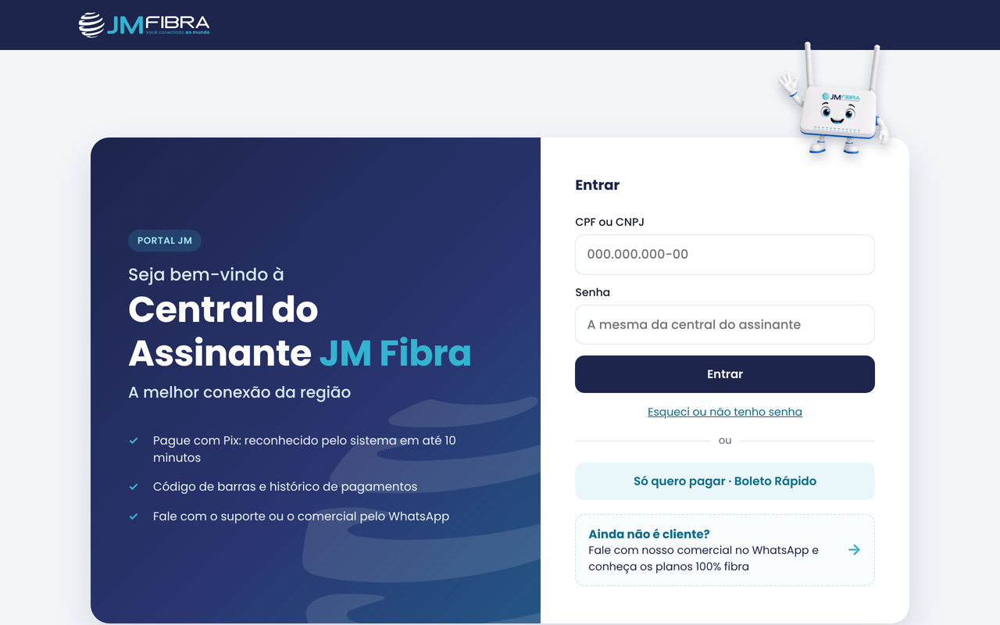
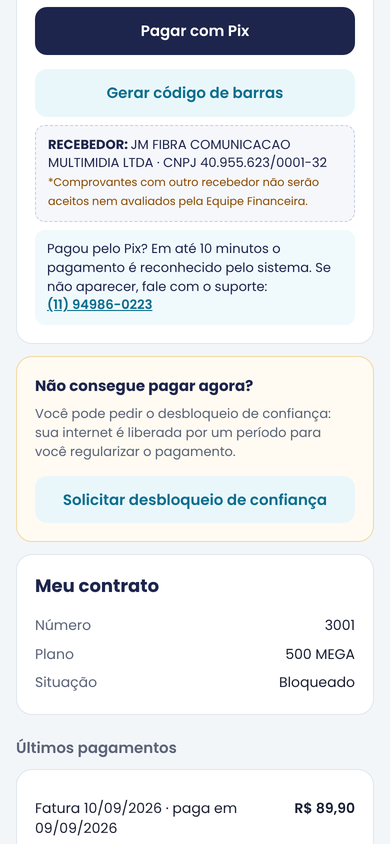
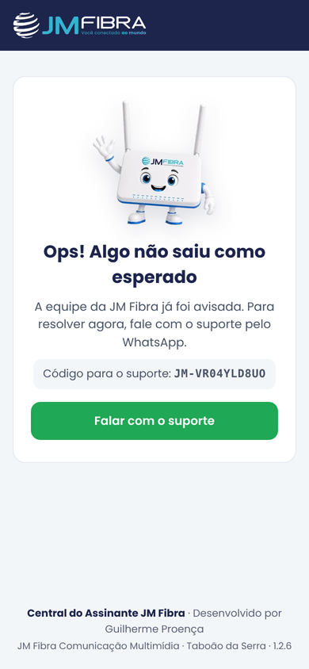
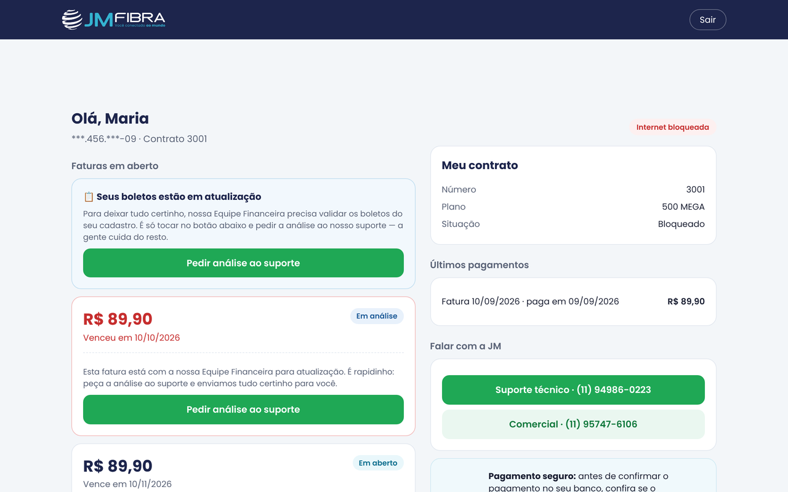
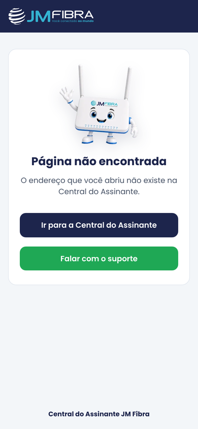
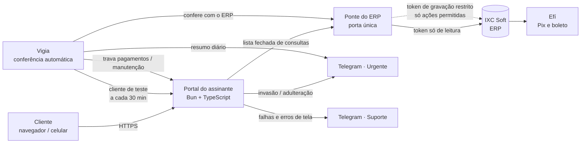

# Central do Assinante JM Fibra: case de produto e engenharia

**Portal de autoatendimento de um provedor de internet por fibra (FTTH), mais a plataforma interna que o sustenta.**
Em produção em **https://cliente.jmfibra.com.br** desde outubro de 2026, para toda a base de clientes da JM Fibra Comunicação Multimídia (Taboão da Serra, SP).

> Este repositório é uma **vitrine**: conta o problema, as decisões e os resultados. O código de produção fica em repositórios privados da empresa. Por isso aqui não há senhas, tokens, endereços internos, regras exatas de segurança nem dados de clientes. As telas abaixo usam **dados fictícios**.

| Entrada (computador) | Faturas e Pix (celular) | Erro com código de suporte |
|---|---|---|
|  |  |  |
| **Entrada (celular)** | **Faturas (computador)** | **Página 404** |
|  |  |  |

---

## O problema

Num provedor regional, a maior parte do atendimento é repetitiva: "me manda o boleto", "qual o Pix?", "minha internet foi cortada, já paguei". Cada pedido desses ocupa o suporte no WhatsApp. O ERP do provedor (IXC Soft) tem essas informações, mas:

- a central do assinante padrão não acompanhava a identidade nem as regras da empresa;
- dar acesso direto ao ERP a qualquer sistema novo é um risco: o mesmo ERP guarda **todos** os clientes, o financeiro e as configurações;
- golpes com **Pix e boleto adulterados** são comuns no setor. Um portal de pagamento comprometido é um alvo valioso.

## A solução

Um portal próprio, instalável no celular, em que o cliente:

- entra com CPF/CNPJ e senha, ou usa o **Boleto Rápido** (só o CPF, para quem só quer pagar);
- vê faturas em aberto, **paga com Pix** (QR e copia e cola) ou **gera o código de barras** na hora;
- confere o **recebedor oficial** (razão social e CNPJ) em todo pagamento, como defesa contra golpe;
- pede **desbloqueio de confiança** quando está bloqueado por falta de pagamento, com regras de elegibilidade;
- fala com o suporte ou o comercial pelo WhatsApp, já com o contexto.

Em volta do portal, uma plataforma de operação: **porta única para o ERP**, **vigia** que confere os pagamentos sozinho, **alertas no Telegram** separados por gravidade e **modo manutenção** automático.

## Arquitetura

- **Portal** (`assinante`): servidor e telas em Bun + TypeScript, sem framework de front-end. Fontes servidas pelo próprio portal, service worker e página de manutenção offline.
- **Ponte do ERP**: o único caminho até o IXC. O portal só consegue fazer um conjunto fechado de consultas, com campos fixos, cota por hora e respostas filtradas aos campos necessários.
- **Vigia**: serviço independente que, de tempos em tempos, entra no portal como um cliente de teste e confere se o Pix e o boleto exibidos batem com o ERP. Se não baterem, **trava os pagamentos** do portal.
- **Hospedagem**: Railway (serviços e functions), Postgres para estado, deploy contínuo pelo GitHub.

Detalhes em [docs/arquitetura.md](docs/arquitetura.md).

## Segurança: o que foi feito

Revisão guiada pelo **OWASP Top 10:2025**, com testes de ataque em ambiente local (ERP simulado) e validação em produção. Resumo em [docs/seguranca.md](docs/seguranca.md).

- **Menor privilégio no ERP:** dois usuários de API. O de **leitura** só enxerga as tabelas que o portal usa. O de **gravação** teve exclusão, financeiro, configuração e permissões bloqueados. Foram conferidas **2.283 permissões**, com 0 divergências.
- **Pagamento à prova de adulteração:** o Pix só aparece se for um BR Code válido do PSP oficial (CRC, estrutura e URL conferidos). O código de barras só aparece se for do banco oficial, com dígitos verificadores corretos. Qualquer coisa fora do padrão some da tela e gera um alerta urgente.
- **Trava em falha fechada:** se o vigia não responder, os pagamentos ficam travados. O hash do código de pagamento publicado precisa ser o aprovado.
- **Anti-abuso e DDoS em camadas:** limites por aparelho, por IP e globais; bloqueio temporário de IP atacante; modo de proteção automático em ataque distribuído, que volta sozinho; mitigação de borda do provedor de nuvem.
- **Alertas que não viram ruído:** o dono recebe só tentativa de invasão ou adulteração e um "bom dia, está tudo no ar". Falhas comuns vão para o tópico do suporte. Os avisos são limitados para não inundar o Telegram.
- **Sem dado pessoal em log ou alerta:** CPF mascarado na tela; números longos removidos dos relatos de erro.

## Resultados

| Indicador | Valor | Fonte / data |
|---|---|---|
| Requisições atendidas sem erro de servidor | **21.744 requisições, 0 erros 5xx** | Railway, 6 h em 27/10/2026 |
| Pix reais validados pelo verificador | **19 de 19** | conferência com dados reais, out/2026 |
| Códigos de barras reais validados | **14 de 14** | idem |
| Testes automatizados | **37** (portal) + **57** (ponte do ERP) + **9** (vigia) | repositórios privados, 27/10/2026 |
| Jornada ponta a ponta | **30 verificações** e **8 cenários de ataque** | ERP simulado |
| Conferência automática de pagamento | a cada 30 min, das 6h às 23h | logs do vigia |

## Decisões que valem contar

Mais em [docs/decisoes.md](docs/decisoes.md).

1. **O portal nunca calcula valor nem monta Pix.** Ele só mostra o que o ERP e o banco geraram, e confere antes de mostrar.
2. **Erro com código, não tela branca.** Toda falha real mostra uma página com um código (`JM-XXXX`) e um único botão para o suporte. O mesmo código chega no Telegram do suporte, então o atendente acha o problema na hora.
3. **Publicar código de pagamento tem ritual:** primeiro o vigia passa a aceitar o hash novo, depois o deploy, depois o hash antigo sai. Assim o portal nunca trava por engano.
4. **Rede de segurança com prazo:** quando o token de leitura é recusado, a consulta é refeita pelo de gravação (só leitura, nunca tabela sensível) e gera um aviso. Isso serve para achar permissões que faltam, e a rede é desligada depois.

## Stack

`TypeScript` · `Bun` · `HTML/CSS/JS` sem framework · `Service Worker` · `Postgres` · `Railway` · `GitHub Actions` · `Playwright` (testes de tela) · API do **IXC Soft** · **Efí** (Pix/boleto) · **Telegram Bot API**

## Meu papel

**Guilherme Proença**: idealização, produto e desenho da solução; definição das regras de negócio e de segurança; integração com ERP, banco e Telegram; configuração das permissões no ERP; validação em produção e implantação para a equipe. O desenvolvimento contou com IA (Claude) como par de programação.

---

JM Fibra é marca da JM Fibra Comunicação Multimídia LTDA. Telas com dados fictícios. O código-fonte de produção não é público.
