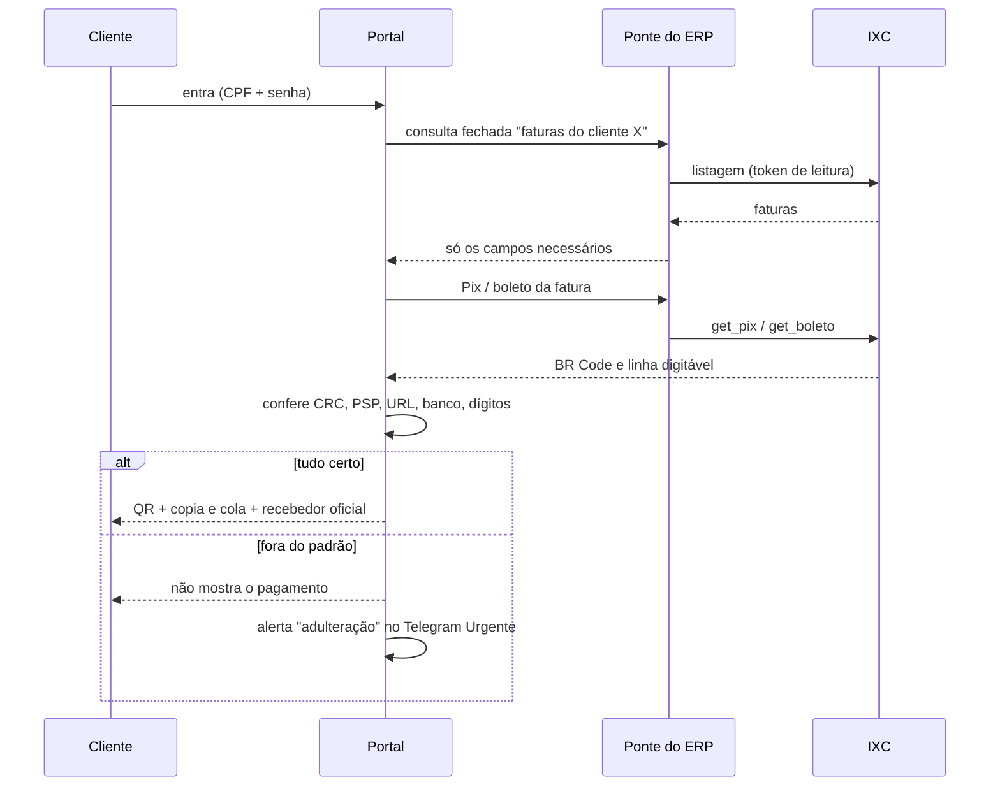

# Arquitetura

## Peças

| Peça | Papel | Tecnologia |
|---|---|---|
| **Portal do assinante** | Login, faturas, Pix, código de barras, Boleto Rápido, desbloqueio de confiança, páginas de erro e 404 | Bun + TypeScript; front em HTML/CSS/JS puro; service worker |
| **Ponte do ERP** | Único caminho até o IXC. Lista fechada de consultas por cliente (portal, central interna, agente), cota por hora, campos de resposta fixos | Bun (Railway Function) |
| **Vigia** | Conferência automática de Pix/boleto, trava de pagamentos, modo manutenção, resumo diário, vencimento de domínio | Bun (Railway Function) + Postgres |
| **Central interna** | Painel da equipe: aba "Portal JM" para ligar/desligar manutenção e ver o estado | Bun + Postgres |
| **Alertas** | Grupo no Telegram com tópicos (Urgente, Suporte, Cobrança, Rede…) | Telegram Bot API |

## Fluxo de uma fatura

## Vigia: a segunda opinião

1. A cada 30 minutos (6h–23h), o vigia entra no portal por uma rota interna autenticada, usando um cliente de teste.
2. Compara cada Pix e cada código de barras exibidos com o que o ERP tem para a mesma fatura.
3. Confere se o hash do código de pagamento publicado é o aprovado.
4. Se algo não bater, **trava os pagamentos**: o portal passa a mostrar só o contato do suporte.
5. Toda manhã manda um resumo: "Portal online e operando · N/M conferências ok em 24 h".

O portal funciona em **falha fechada**: sem resposta do vigia, os pagamentos ficam travados.

## Manutenção e proteção

- **Manual:** pela Central interna.
- **Automática:** se o ERP cair, ou por alguns minutos durante um ataque distribuído. Volta sozinha.
- **Offline:** o service worker mostra a página "Já voltamos" mesmo se o servidor estiver fora.

## Publicação

- O portal publica sozinho a cada push na `main` (GitHub → Railway).
- A ponte e o vigia são functions: a mudança fica preparada e só entra no ar quando um responsável aprova no painel.
- Um workflow do GitHub avisa no tópico Urgente quando alguém mexe em código de pagamento, na ponte, no vigia ou na própria configuração do CI.
